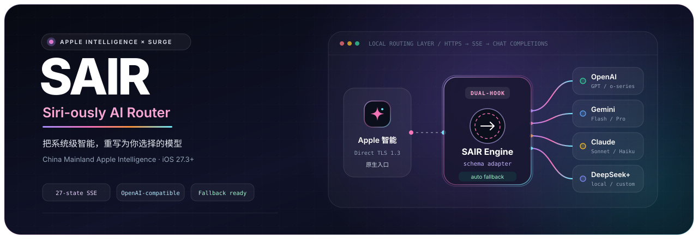
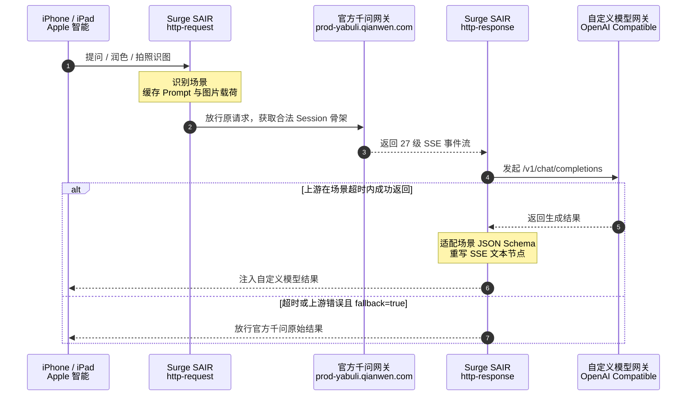

<div align="center">



<br />

[](#环境要求)
[](sgmodule/sair.sgmodule)
[](loon/sair.plugin)
[](#主流服务商配置示例)
[](docs/protocol_analysis.md)
[](LICENSE)

<p align="center">
  <b>Your Intelligence. Your Models.</b><br />
  专为中国大陆版 Apple 智能（iOS 27.3+）打造的轻量化、零依赖自定义大模型路由适配器
</p>

<p align="center">
  <b>简体中文</b> &nbsp;｜&nbsp; <a href="README_EN.md">English</a>
</p>

<p align="center">
  <a href="#核心特性">核心特性</a> ·
  <a href="#工作原理与架构">工作原理</a> ·
  <a href="#快速开始">快速开始</a> ·
  <a href="#一键安装">一键安装</a> ·
  <a href="#参数与配置参考">参数配置</a> ·
  <a href="#主流服务商配置示例">配置示例</a> ·
  <a href="#常见问题">常见问题</a>
</p>

</div>

---

## 项目简介

国行版 **Apple 智能（Apple Intelligence）** 在调用第三方扩展能力时，会由设备直接通过标准 TLS 1.3 连接请求阿里云通义千问网关（`prod-yabuli.qianwen.com`）。SAIR 利用这一网络特征，通过 **Surge 或 Loon** 的 `http-request` 与 `http-response` 双阶段脚本，在设备本地完成透明拦截、请求转接和 SSE 回包重写。

安装完成后，系统级**写作工具**、**Siri 智能问答**和**视觉智能相机**仍然使用原生入口与交互界面，但底层生成模型可以切换到任意兼容 OpenAI `/v1/chat/completions` 的服务，包括 OpenAI、Gemini、Claude、DeepSeek、OpenRouter 以及自建 Ollama / vLLM 网关。

> [!TIP]
> 想先体验功能，直接从[快速开始](#快速开始)开始；想了解完整数据契约和 27 级 SSE 状态机，再阅读 [`docs/protocol_analysis.md`](docs/protocol_analysis.md)。

## 核心特性

| 能力 | 说明 |
| :--- | :--- |
| **三大原生场景** | 覆盖写作工具、Siri 语音/文本问答和视觉智能识图，并保留原生 UI 动效与交互。 |
| **27 级 SSE 重写** | 保留 Apple 智能原始事件流骨架，只替换最终文本载荷和场景所需的 JSON Schema。 |
| **多模态直通** | 递归提取相机控制产生的 Base64 图片或图片 URL，转换为 OpenAI Vision 兼容的 `image_url` 消息。 |
| **按场景超时** | 为 Siri、视觉智能和写作工具分别设置超时窗口，减少客户端提前断开。 |
| **官方回退保护** | 自定义网关超时或返回错误时，可自动放行官方千问原始回包。 |
| **Safari 诊断入口** | 通过 `/sair/status` 查看脱敏运行配置，通过 `/sair/models` 探测上游模型列表。 |

### 原生场景适配

- **写作工具（`compose_selectedAndAllText`）**：输出 `{"body": "...", "refinements": ["..."]}`，保留正文和原生润色建议按钮。
- **Siri 问答（`siri.tqa`）**：输出 `{"content": "...", "suggestions": ["..."], "summary": "..."}`，驱动摘要卡片、语音朗读和追问气泡。
- **视觉智能（`siri.visualIntelligenceCamera`）**：识别相机图像输入，并组装为标准多模态消息后交给上游模型。

## 工作原理与架构



完整网络拓扑、事件层级和 JSON 数据契约见 [`docs/protocol_analysis.md`](docs/protocol_analysis.md)。

## 快速开始

### 环境要求

1. **设备与系统**：运行 iOS 27.3+、已启用国行 Apple 智能的 iPhone 或 iPad。
2. **代理客户端**：Surge iOS 5.x+（开启 **MITM**、**Rewrite** 和 **Scripting**），或 Loon 3.5.1 (983)+。
3. **证书信任**：在“设置 → 通用 → 关于本机 → 证书信任设置”中完全信任所选客户端的 MITM CA 根证书。
4. **模型凭证**：准备一个支持 OpenAI `/v1/chat/completions` 的上游服务和 API Key。

### 一键安装

这是推荐的安装方式。

下面的入口用于打开对应客户端的导入流程。导入完成后仍需在模块 / 插件参数中填写
上游地址和 API Key，并按客户端要求开启 MITM 和证书信任。

一键导入使用最新 Release 资产；模块和插件运行时引用的适配脚本固定使用 `main` 地址。

<table>
  <thead>
    <tr>
      <th>Surge</th>
      <th>Loon</th>
    </tr>
  </thead>
  <tbody>
    <tr>
      <td>
        <a href="surge:///install-module?url=https%3A%2F%2Fgithub.com%2Fboitar%2Fsair%2Freleases%2Flatest%2Fdownload%2FSAIR.sgmodule">点击一键导入 Surge 模块</a>
      </td>
      <td>
        <a href="https://www.nsloon.com/openloon/import?plugin=https%3A%2F%2Fgithub.com%2Fboitar%2Fsair%2Freleases%2Flatest%2Fdownload%2FSAIR.plugin">点击一键导入 Loon 插件</a>
        <br />
        <sub><a href="loon://import?plugin=https%3A%2F%2Fgithub.com%2Fboitar%2Fsair%2Freleases%2Flatest%2Fdownload%2FSAIR.plugin">使用 Loon Scheme</a></sub>
      </td>
    </tr>
  </tbody>
</table>

### 手动安装 Surge 模块

如果一键链接没有唤起 Surge，也可以在 Surge iOS 中打开 **模块 → 安装新模块**，填入：

```text
https://raw.githubusercontent.com/boitar/sair/custom/sgmodule/sair.sgmodule
```

模块会自动追加 MITM 主机名，并注册 SAIR 的请求与响应双阶段脚本。

### 手动安装 Loon 插件

如果一键链接没有唤起 Loon，在 Loon 中打开 **插件 → 添加插件**，填入：

```text
https://raw.githubusercontent.com/boitar/sair/custom/loon/sair.plugin
```

启用插件后，Loon 会显示 SAIR 的可调参数。

### 配置模型网关

在 Surge 的 **模块 → SAIR → 编辑参数**，或 Loon 的 SAIR 插件参数面板中，填入你的上游地址和 API Key：

```ini
endpoint=https://api.openai.com/v1/chat/completions&api_key=sk-your-api-key&model=gpt-4o-mini
```

如果只填写服务商的 `/v1` 基础地址，脚本会自动补全 `/chat/completions`。

Loon 插件会把同一份 [`scripts/sair_adapter.js`](scripts/sair_adapter.js) 注册为请求与响应脚本，
并自动追加 `prod-yabuli.qianwen.com` 的 MITM 主机名。`notify`、`fallback` 和三个场景超时也可以
直接在插件参数中调整；脚本会同时兼容 Loon 的参数对象和 Surge 的 `key=value` 参数字符串。

### 在线验证

保持所选代理客户端运行，在 Safari 中访问：

- **运行状态与生效配置**：[`https://prod-yabuli.qianwen.com/sair/status`](https://prod-yabuli.qianwen.com/sair/status)
- **上游模型列表**：[`https://prod-yabuli.qianwen.com/sair/models`](https://prod-yabuli.qianwen.com/sair/models)

`/sair/status` 只展示脱敏后的 API Key；如果页面无法打开，优先检查 MITM 主机名和证书信任。

## 参数与配置参考

### 模块 / 插件参数

| 参数 | 默认值 | 说明 |
| :--- | :--- | :--- |
| `endpoint` | `https://api.openai.com/v1/chat/completions` | OpenAI 兼容的对话补全地址；可以填写 `/v1` 基础路径。 |
| `api_key` | *(空)* | 上游 API Key，脚本会作为 `Bearer` Token 写入请求头。 |
| `model` | `gpt-4o-mini` | 目标模型名称；视觉智能场景需要模型支持图片输入。 |
| `notify` | `error` | `error` 只通知错误/回退，`all` 通知全部阶段，`none` 完全静默。 |
| `fallback` | `true` | `true` 时超时或错误会放行官方千问；`false` 时返回 HTTP `504`。 |
| `timeout_siri` | `7` | Siri 问答超时秒数，默认值适配约 6~8 秒的客户端等待窗口。 |
| `timeout_vision` | `10` | 视觉智能超时秒数。 |
| `timeout_writing` | `15` | 写作工具超时秒数。 |

### 配置优先级

同一配置项同时存在时，优先级为：

```text
$persistentStore 覆写 > 客户端模块 / 插件参数 > 脚本默认值
```

可用的持久化 Key：

| 持久化 Key | 对应参数 | 示例值 |
| :--- | :--- | :--- |
| `SAIR_ENDPOINT` | `endpoint` | `https://api.deepseek.com/v1/chat/completions` |
| `SAIR_API_KEY` | `api_key` | `sk-...` |
| `SAIR_MODEL` | `model` | `deepseek-chat` |
| `SAIR_NOTIFY` | `notify` | `error` / `all` / `none` |
| `SAIR_FALLBACK` | `fallback` | `true` / `false` |

### 当前固定的上游请求参数

以下参数目前由 [`scripts/sair_adapter.js`](scripts/sair_adapter.js) 固定写入上游请求，不属于模块参数：

| 参数 | 当前值 |
| :--- | :--- |
| `reasoning_effort` | `low` |
| `max_tokens` | `400` |
| `temperature` | `0.7` |

## 主流服务商配置示例

> [!TIP]
> Siri 对第三方扩展存在严格的 6~8 秒等待窗口，建议优先选择首字延迟低的模型；视觉智能场景还需要上游模型支持图像输入。

**OpenAI 官方**

```ini
endpoint=https://api.openai.com/v1/chat/completions&api_key=sk-proj-xxxx&model=gpt-4o-mini&notify=error&fallback=true
```

**Google Gemini（OpenAI 兼容接口）**

```ini
endpoint=https://generativelanguage.googleapis.com/v1beta/openai/chat/completions&api_key=AIzaSyXXXX&model=gemini-2.5-flash&notify=error&fallback=true
```

**DeepSeek 官方**

```ini
endpoint=https://api.deepseek.com/v1/chat/completions&api_key=sk-xxxx&model=deepseek-chat&notify=error&fallback=true
```

**OpenRouter 聚合网关**

```ini
endpoint=https://openrouter.ai/api/v1/chat/completions&api_key=sk-or-v1-xxxx&model=google/gemini-2.5-flash&notify=error&fallback=true
```

## 兼容性与已知限制

- SAIR 已提供 Surge iOS 5.x+ 模块和 Loon 3.5.1 (983)+ 插件，两者共用同一个双阶段适配脚本。
- Loon 插件使用新版 Script 语法传入参数对象；如果使用更早版本的 Loon，请升级到插件声明的最低版本。
- 系统必须仍能访问官方千问通道；SAIR 需要原始请求和 SSE 会话骨架来完成响应重写。
- Siri 场景的等待窗口较短，复杂推理模型可能触发官方回退。
- 视觉智能图片会占用代理脚本请求体缓冲区；Surge 模块已将 `max-size` 配置为 `16777216`（16 MB）。
- 项目只处理兼容 OpenAI Chat Completions 的上游接口，不负责把非兼容协议转换成 OpenAI 格式。

## 项目结构

```text
SAIR/
├── assets/
│   └── banner.svg              # README 头图与路由架构视觉
├── docs/
│   └── protocol_analysis.md    # 网络拓扑与 27 级 SSE 协议分析
├── scripts/
│   └── sair_adapter.js         # Surge / Loon 双阶段适配器与 SSE 重写脚本
├── sgmodule/
│   └── sair.sgmodule           # Surge iOS 模块定义
├── loon/
│   └── sair.plugin             # Loon 插件定义与可调参数
├── LICENSE                     # MIT 开源许可证
├── README.md                   # 中文主文档
└── README_EN.md                # English documentation
```

## 常见问题

<details>
<summary><b>1. 为什么 Siri 有时仍然回答官方千问的内容？</b></summary>
<br />

通常是上游模型超过 `timeout_siri`（默认 7 秒）仍未完成，或 API 返回了错误，SAIR 因 `fallback=true` 自动放行了官方千问回包。可以临时将 `notify` 设为 `all` 查看通知原因，或换用更快的模型。
</details>

<details>
<summary><b>2. 访问 /sair/status 打不开或提示证书错误怎么办？</b></summary>
<br />

确认所选客户端的 MITM 已开启、`prod-yabuli.qianwen.com` 已在 MITM 主机名列表中，并且系统证书信任设置已完全信任对应 CA 根证书。
</details>

<details>
<summary><b>3. 是否支持 Loon、Quantumult X 或 Stash？</b></summary>
<br />

当前版本已经提供 Loon 插件，直接安装 [`loon/sair.plugin`](loon/sair.plugin) 即可。Quantumult X 和 Stash
仍需要自行迁移规则，并映射 [`scripts/sair_adapter.js`](scripts/sair_adapter.js) 使用的
`$httpClient`、`$persistentStore` 与双阶段 `$done` 生命周期。
</details>

## 免责声明

本项目仅用于网络协议逆向分析、网络安全评估与个人技术研究。

- **Apple**、**iOS**、**Siri**、**Apple Intelligence** 均为 Apple Inc. 的注册商标；**通义千问**为阿里巴巴集团注册商标。
- 本项目与上述公司不存在任何官方关联或商业合作。使用者应遵守所在地法律法规及各 API 服务商的使用条款，因使用本项目产生的一切风险与后果由使用者自行承担。

## 开源许可

本项目基于 [MIT License](LICENSE) 开源。Copyright © 2026 boitar.
