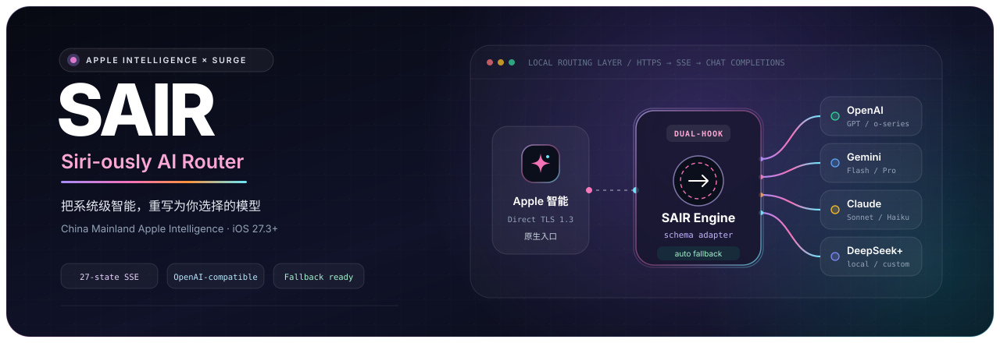
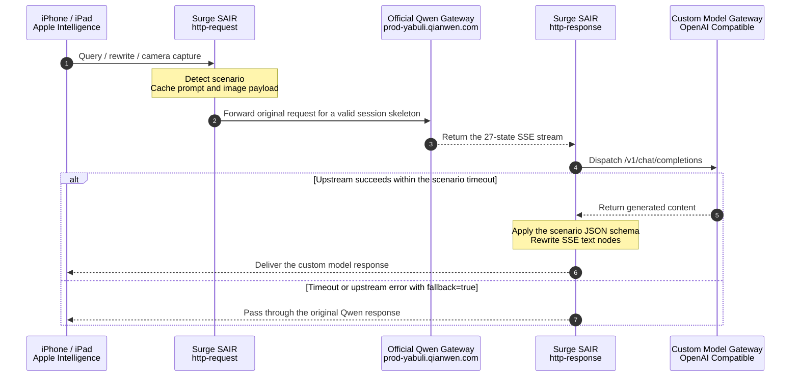

<div align="center">



<br />

[](#prerequisites)
[](sgmodule/sair.sgmodule)
[](#provider-configuration-examples)
[](docs/protocol_analysis.md)
[](LICENSE)

<p align="center">
  <b>Your Intelligence. Your Models.</b><br />
  A lightweight, zero-dependency model router for Mainland China Apple Intelligence (iOS 27.3+) powered by Surge.
</p>

<p align="center">
  <a href="README.md">简体中文</a> &nbsp;｜&nbsp; <b>English</b>
</p>

<p align="center">
  <a href="#key-features">Key features</a> ·
  <a href="#architecture-and-request-flow">Architecture</a> ·
  <a href="#quick-start">Quick start</a> ·
  <a href="#configuration-reference">Configuration</a> ·
  <a href="#provider-configuration-examples">Examples</a> ·
  <a href="#faq">FAQ</a>
</p>

</div>

---

## Overview

**Apple Intelligence** extensions in Mainland China connect directly from the device to Alibaba's Qwen gateway (`prod-yabuli.qianwen.com`) over standard TLS 1.3. SAIR uses Surge's `http-request` and `http-response` hooks to transparently intercept the flow, dispatch the prompt to a custom model gateway, and rewrite the returned SSE payload on-device.

The native **Writing Tools**, **Siri QA**, and **Visual Intelligence** entry points remain unchanged. The underlying model can be switched to any provider compatible with OpenAI `/v1/chat/completions`, including OpenAI, Gemini, Claude, DeepSeek, OpenRouter, or self-hosted Ollama / vLLM gateways.

> [!TIP]
> Start with [Quick start](#quick-start) if you want to try it immediately. Read [`docs/protocol_analysis.md`](docs/protocol_analysis.md) for the full network flow, event hierarchy, and payload contracts.

## Key features

| Capability | Description |
| :--- | :--- |
| **Three native scenarios** | Supports Writing Tools, Siri conversational QA, and Visual Intelligence while preserving the native UI flow. |
| **27-state SSE rewrite** | Preserves Apple's original event skeleton while replacing the final text payload and scenario-specific JSON schema. |
| **Multimodal passthrough** | Recursively extracts Base64 images or image URLs and converts them into OpenAI Vision-compatible `image_url` messages. |
| **Scenario-aware timeouts** | Uses separate timeout windows for Siri, Visual Intelligence, and Writing Tools to reduce client disconnects. |
| **Official fallback** | Passes through the original Qwen response when the custom gateway times out or returns an error. |
| **Safari inspector** | Use `/sair/status` for a masked runtime configuration and `/sair/models` to discover upstream models. |

### Native scenario adaptation

- **Writing Tools (`compose_selectedAndAllText`)**: Produces `{"body": "...", "refinements": ["..."]}` so the native refinement buttons remain available.
- **Siri QA (`siri.tqa`)**: Produces `{"content": "...", "suggestions": ["..."], "summary": "..."}` for the summary card, voice readout, and follow-up chips.
- **Visual Intelligence (`siri.visualIntelligenceCamera`)**: Detects camera image input and sends it upstream as a standard multimodal message.

## Architecture and request flow



See [`docs/protocol_analysis.md`](docs/protocol_analysis.md) for the complete topology, event hierarchy, and JSON contracts.

## Quick start

### Prerequisites

1. **Device and OS**: An iPhone or iPad running iOS 27.3+ with Mainland China Apple Intelligence enabled.
2. **Surge iOS**: Surge iOS 5.x+ with **MITM**, **Rewrite**, and **Scripting** enabled.
3. **Certificate trust**: Fully trust the Surge CA certificate under *Settings → General → About → Certificate Trust Settings*.
4. **Provider credentials**: An upstream service and API key compatible with OpenAI `/v1/chat/completions`.

### Step 1: Install the Surge module

In Surge iOS, open **Modules → Install New Module** and enter:

```text
https://raw.githubusercontent.com/boitar/sair/main/sgmodule/sair.sgmodule
```

The module adds the MITM hostname and registers SAIR's request and response hooks automatically.

### Step 2: Configure the model gateway

Open **Modules → SAIR → Edit Arguments** and enter your provider endpoint and API key:

```ini
endpoint=https://api.openai.com/v1/chat/completions&api_key=sk-your-api-key&model=gpt-4o-mini
```

If you provide only a provider's `/v1` base URL, the script appends `/chat/completions` automatically.

### Step 3: Verify in Safari

Keep Surge running and open these endpoints in Safari:

- **Runtime status and active configuration**: [`https://prod-yabuli.qianwen.com/sair/status`](https://prod-yabuli.qianwen.com/sair/status)
- **Upstream model discovery**: [`https://prod-yabuli.qianwen.com/sair/models`](https://prod-yabuli.qianwen.com/sair/models)

`/sair/status` exposes only a masked API key. If it does not load, check the MITM hostname and certificate trust first.

## Configuration reference

### Module arguments

| Parameter | Default | Description |
| :--- | :--- | :--- |
| `endpoint` | `https://api.openai.com/v1/chat/completions` | OpenAI-compatible chat completions URL; a `/v1` base URL is also accepted. |
| `api_key` | *(empty)* | Upstream API key, sent as a `Bearer` token. |
| `model` | `gpt-4o-mini` | Target model name; Visual Intelligence requires image input support. |
| `notify` | `error` | `error` notifies on errors/fallbacks, `all` notifies every stage, and `none` stays silent. |
| `fallback` | `true` | `true` passes through the official Qwen response on failure; `false` returns HTTP `504`. |
| `timeout_siri` | `7` | Siri timeout in seconds, tuned for the client's roughly 6–8 second window. |
| `timeout_vision` | `10` | Visual Intelligence timeout in seconds. |
| `timeout_writing` | `15` | Writing Tools timeout in seconds. |

### Configuration precedence

When the same option is set in multiple places, the order is:

```text
$persistentStore override > Surge module argument > script default
```

Supported persistent store keys:

| Persistent key | Target option | Example value |
| :--- | :--- | :--- |
| `SAIR_ENDPOINT` | `endpoint` | `https://api.deepseek.com/v1/chat/completions` |
| `SAIR_API_KEY` | `api_key` | `sk-...` |
| `SAIR_MODEL` | `model` | `deepseek-chat` |
| `SAIR_NOTIFY` | `notify` | `error` / `all` / `none` |
| `SAIR_FALLBACK` | `fallback` | `true` / `false` |

### Fixed upstream request options

The following values are currently written by [`scripts/sair_adapter.js`](scripts/sair_adapter.js) and are not module arguments:

| Option | Current value |
| :--- | :--- |
| `reasoning_effort` | `low` |
| `max_tokens` | `400` |
| `temperature` | `0.7` |

## Provider configuration examples

> [!TIP]
> Siri has a strict 6–8 second client-side window, so low-latency models are recommended. Visual Intelligence also requires image input support from the upstream model.

**OpenAI**

```ini
endpoint=https://api.openai.com/v1/chat/completions&api_key=sk-proj-xxxx&model=gpt-4o-mini&notify=error&fallback=true
```

**Google Gemini (OpenAI-compatible endpoint)**

```ini
endpoint=https://generativelanguage.googleapis.com/v1beta/openai/chat/completions&api_key=AIzaSyXXXX&model=gemini-2.5-flash&notify=error&fallback=true
```

**DeepSeek**

```ini
endpoint=https://api.deepseek.com/v1/chat/completions&api_key=sk-xxxx&model=deepseek-chat&notify=error&fallback=true
```

**OpenRouter**

```ini
endpoint=https://openrouter.ai/api/v1/chat/completions&api_key=sk-or-v1-xxxx&model=google/gemini-2.5-flash&notify=error&fallback=true
```

## Compatibility and known limitations

- SAIR targets Surge iOS 5.x+ and its dual-hook scripting lifecycle. Other proxy clients require their own API and rule adaptations.
- The official Qwen channel must remain reachable because SAIR uses the original request and SSE session skeleton for response rewriting.
- Siri's waiting window is short, so complex reasoning models may trigger the official fallback.
- Visual Intelligence images consume Surge's request-body buffer; the module sets `max-size` to `16777216` (16 MB).
- SAIR handles OpenAI Chat Completions-compatible upstreams. It does not translate arbitrary provider protocols.

## Repository structure

```text
SAIR/
├── assets/
│   └── banner.svg              # README hero image and routing visual
├── docs/
│   └── protocol_analysis.md    # Network topology and 27-state SSE analysis
├── scripts/
│   └── sair_adapter.js         # Dual-hook adapter and SSE rewriter
├── sgmodule/
│   └── sair.sgmodule           # Surge iOS module definition
├── LICENSE                     # MIT License
├── README.md                   # Primary Simplified Chinese documentation
└── README_EN.md                # English documentation
```

## FAQ

<details>
<summary><b>1. Why does Siri sometimes still return the official Qwen response?</b></summary>
<br />

The upstream model usually exceeded `timeout_siri` (7 seconds by default) or returned an error. With `fallback=true`, SAIR releases the original Qwen response automatically. Temporarily set `notify=all` to inspect the reason, or switch to a faster model.
</details>

<details>
<summary><b>2. Why is /sair/status unreachable or showing a certificate warning?</b></summary>
<br />

Make sure Surge MITM is enabled, `prod-yabuli.qianwen.com` is included in the MITM hostname list, and the Surge CA certificate is fully trusted by iOS.
</details>

<details>
<summary><b>3. Does this support Quantumult X, Loon, or Stash?</b></summary>
<br />

The current version is verified against Surge iOS's dual-hook lifecycle. Porting requires adapting the rules in [`sgmodule/sair.sgmodule`](sgmodule/sair.sgmodule) and mapping the `$httpClient` and `$persistentStore` APIs used by [`scripts/sair_adapter.js`](scripts/sair_adapter.js).
</details>

## Disclaimer

This project is intended solely for network protocol research, security evaluation, and personal educational use.

- **Apple**, **iOS**, **Siri**, and **Apple Intelligence** are registered trademarks of Apple Inc. **Qwen (通义千问)** is a registered trademark of Alibaba Group.
- This project is not affiliated with, endorsed by, or sponsored by Apple Inc. or Alibaba Group. Users are responsible for complying with applicable laws and provider terms.

## License

Released under the [MIT License](LICENSE). Copyright © 2026 boitar.
