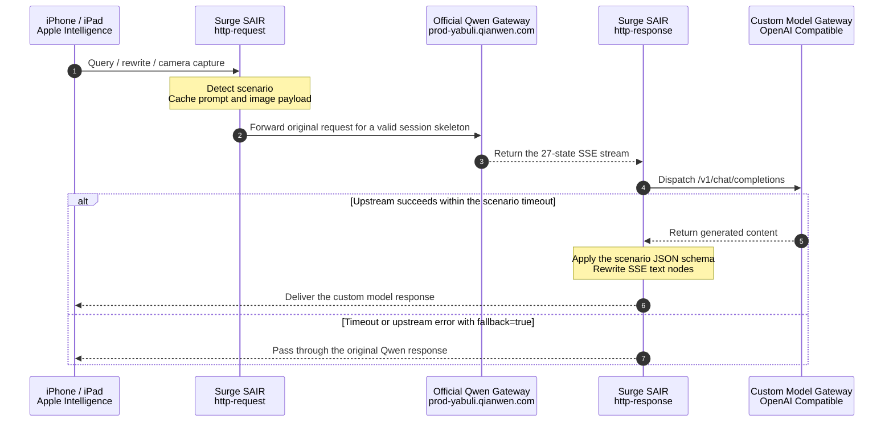

<div align="center">


<br />

[](#prerequisites)
[](#manual-surge-module-installation)
[](#manual-loon-plugin-installation)
[](#manual-stash-override-installation)
[](#manual-shadowrocket-module-installation)
[](#manual-quantumult-x-snippet-installation)
[](#manual-egern-module-installation)
[](#provider-configuration-examples)
[](docs/protocol_analysis.md)
[](LICENSE)

<p align="center">
  <b>Your Intelligence. Your Models.</b><br />
  A lightweight, zero-dependency model router for Mainland China Apple Intelligence (iOS 27.3+) across major iOS proxy clients.
</p>

<p align="center">
  <a href="README.md">简体中文</a> &nbsp;｜&nbsp; <b>English</b>
</p>

<p align="center">
  <a href="#key-features">Key features</a> ·
  <a href="#architecture-and-request-flow">Architecture</a> ·
  <a href="#quick-start">Quick start</a> ·
  <a href="#one-click-installation">One-click install</a> ·
  <a href="#configuration-reference">Configuration</a> ·
  <a href="#provider-configuration-examples">Examples</a> ·
  <a href="#faq">FAQ</a>
</p>

</div>

---

## Overview

**Apple Intelligence** extensions in Mainland China connect directly from the device to Alibaba's Qwen gateway (`prod-yabuli.qianwen.com`) over standard TLS 1.3. SAIR uses Surge, Loon, Stash, Shadowrocket, Quantumult X, or Egern dual-phase hooks and rewrites to transparently intercept the flow, dispatch the prompt to a custom model gateway, and rewrite the returned SSE payload on-device.

The native **Writing Tools**, **Siri QA**, and **Visual Intelligence** entry points remain unchanged. The underlying model can be switched to any provider compatible with OpenAI `/v1/chat/completions`, including OpenAI, Gemini, Claude, DeepSeek, OpenRouter, or self-hosted Ollama / vLLM gateways.

> [!TIP]
> Start with [Quick start](#quick-start) if you want to try it immediately. Read [`docs/protocol_analysis.md`](docs/protocol_analysis.md) for the full network flow, event hierarchy, and payload contracts.

## Key features

| Capability | Description |
| :--- | :--- |
| **Three native scenarios** | Supports Writing Tools, Siri conversational QA, and Visual Intelligence while preserving the native UI flow. |
| **27-state SSE rewrite** | Preserves Apple's original event skeleton while replacing the final text payload and scenario-specific JSON schema. |
| **Multimodal passthrough** | Recursively extracts Base64 images or image URLs and converts them into OpenAI Vision-compatible `image_url` messages. |
| **Scenario-aware timeouts** | Uses separate timeout windows for Siri, Visual Intelligence, and Writing Tools to reduce client disconnects. |
| **Official fallback** | Passes through the original Qwen response when the custom gateway times out or returns an error. |
| **Safari inspector** | Use `/sair/status` for a masked runtime configuration and `/sair/models` to discover upstream models. |

### Native scenario adaptation

- **Writing Tools (`compose_selectedAndAllText`)**: Produces `{"body": "...", "refinements": ["..."]}` so the native refinement buttons remain available.
- **Siri QA (`siri.tqa`)**: Produces `{"content": "...", "suggestions": ["..."], "summary": "..."}` for the summary card, voice readout, and follow-up chips.
- **Visual Intelligence (`siri.visualIntelligenceCamera`)**: Detects camera image input and sends it upstream as a standard multimodal message.

## Architecture and request flow



See [`docs/protocol_analysis.md`](docs/protocol_analysis.md) for the complete topology, event hierarchy, and JSON contracts.

## Quick start

### Prerequisites

1. **Device and OS**: An iPhone or iPad running iOS 27.3+ with Mainland China Apple Intelligence enabled.
2. **Proxy client**: Surge iOS 5.x+, Loon 3.5.1+, Stash 2.5+, Shadowrocket, Quantumult X 1.0.30+, or Egern with **MITM** and **Scripting/Rewrite** enabled.
3. **Certificate trust**: Fully trust the selected client's MITM CA certificate under *Settings → General → About → Certificate Trust Settings*.
4. **Provider credentials**: An upstream service and API key compatible with OpenAI `/v1/chat/completions`.

### One-click installation

> [!TIP]
> 🚀 **[Open Web Installation Portal (supports Safari one-click import into proxy apps)](https://boitar.github.io/sair/)**
> Open the page in iOS Safari and tap any install button to trigger native client installation for Surge, Loon, Stash, Egern, Quantumult X, or Shadowrocket.

You can also trigger client import directly using the official **URL Scheme** links or copy the addresses:

| Client | Quick Import Scheme | Release Direct Download |
| :--- | :--- | :--- |
| **Surge** | [Install Surge Module](surge:///install-module?url=https%3A%2F%2Fgithub.com%2Fboitar%2Fsair%2Freleases%2Flatest%2Fdownload%2Fsair.sgmodule)<br />`surge:///install-module?url=https%3A%2F%2Fgithub.com%2Fboitar%2Fsair%2Freleases%2Flatest%2Fdownload%2Fsair.sgmodule` | [`sair.sgmodule`](https://github.com/boitar/sair/releases/latest/download/sair.sgmodule) |
| **Loon** | [Install Loon Plugin](loon://import?plugin=https%3A%2F%2Fgithub.com%2Fboitar%2Fsair%2Freleases%2Flatest%2Fdownload%2Fsair.plugin)<br />`loon://import?plugin=https%3A%2F%2Fgithub.com%2Fboitar%2Fsair%2Freleases%2Flatest%2Fdownload%2Fsair.plugin` | [`sair.plugin`](https://github.com/boitar/sair/releases/latest/download/sair.plugin) |
| **Stash** | [Install Stash Override](stash://install-override?url=https%3A%2F%2Fgithub.com%2Fboitar%2Fsair%2Freleases%2Flatest%2Fdownload%2Fsair.stoverride)<br />`stash://install-override?url=https%3A%2F%2Fgithub.com%2Fboitar%2Fsair%2Freleases%2Flatest%2Fdownload%2Fsair.stoverride` | [`sair.stoverride`](https://github.com/boitar/sair/releases/latest/download/sair.stoverride) |
| **Egern** | [Install Egern Module](egern:///modules/new?url=https%3A%2F%2Fgithub.com%2Fboitar%2Fsair%2Freleases%2Flatest%2Fdownload%2Fsair.yaml)<br />`egern:///modules/new?url=https%3A%2F%2Fgithub.com%2Fboitar%2Fsair%2Freleases%2Flatest%2Fdownload%2Fsair.yaml` | [`sair.yaml`](https://github.com/boitar/sair/releases/latest/download/sair.yaml) |
| **Quantumult X** | [Install QX Snippet](quantumult-x:///add-resource?remote-resource=%7B%22rewrite_remote%22%3A%5B%22https%3A%2F%2Fgithub.com%2Fboitar%2Fsair%2Freleases%2Flatest%2Fdownload%2Fsair.snippet%22%5D%7D)<br />`quantumult-x:///add-resource?remote-resource={"rewrite_remote":["https://github.com/boitar/sair/releases/latest/download/sair.snippet"]}` | [`sair.snippet`](https://github.com/boitar/sair/releases/latest/download/sair.snippet) |
| **Shadowrocket** | [Install Shadowrocket Module](shadowrocket://install?module=https%3A%2F%2Fgithub.com%2Fboitar%2Fsair%2Freleases%2Flatest%2Fdownload%2Fsair.sgmodule)<br />`shadowrocket://install?module=https%3A%2F%2Fgithub.com%2Fboitar%2Fsair%2Freleases%2Flatest%2Fdownload%2Fsair.sgmodule` | [`sair.sgmodule`](https://github.com/boitar/sair/releases/latest/download/sair.sgmodule) |

### Manual Surge module installation

**Path**: `Home > Modify > Modules > Install New Module`

**Release Direct Download (Recommended)**:
```text
https://github.com/boitar/sair/releases/latest/download/sair.sgmodule
```
*(Fallback GitHub Raw: `https://raw.githubusercontent.com/boitar/sair/main/sgmodule/sair.sgmodule`)*

The module adds the MITM hostname and registers SAIR's request and response hooks automatically.

### Manual Loon plugin installation

**Path**: `Configuration > Plugins > Plugins` (+ icon)

**Release Direct Download (Recommended)**:
```text
https://github.com/boitar/sair/releases/latest/download/sair.plugin
```
*(Fallback GitHub Raw: `https://raw.githubusercontent.com/boitar/sair/main/loon/sair.plugin`)*

After enabling it, Loon will show the configurable SAIR arguments.

### Manual Stash override installation

**Path**: `Home > Overrides > Install Override`

**Release Direct Download (Recommended)**:
```text
https://github.com/boitar/sair/releases/latest/download/sair.stoverride
```
*(Fallback GitHub Raw: `https://raw.githubusercontent.com/boitar/sair/main/stash/sair.stoverride`)*

### Manual Shadowrocket module installation

**Path**: `Config > Modules > + (Add from URL)`

**Release Direct Download (Recommended)**:
```text
https://github.com/boitar/sair/releases/latest/download/sair.sgmodule
```
*(Fallback GitHub Raw: `https://raw.githubusercontent.com/boitar/sair/main/shadowrocket/sair.sgmodule`)*

### Manual Quantumult X snippet installation

**Path**: `Rewrite > Remote Resources` (+ icon)

**Release Direct Download (Recommended)**:
```text
https://github.com/boitar/sair/releases/latest/download/sair.snippet
```
*(Fallback GitHub Raw: `https://raw.githubusercontent.com/boitar/sair/main/quantumultx/sair.snippet`)*

### Manual Egern module installation

**Path**: `Tools > Modules > Add Module from URL`

**Release Direct Download (Recommended)**:
```text
https://github.com/boitar/sair/releases/latest/download/sair.yaml
```
*(Fallback GitHub Raw: `https://raw.githubusercontent.com/boitar/sair/main/egern/sair.yaml`)*

### Configure the model gateway

Every client provides convenient native or visual configuration methods:

1. **Surge Native Argument Editor**: In **Modules → SAIR → Edit Arguments**, configure `endpoint`, `api_key`, `model`, `notify`, `fallback`, and scenario timeouts directly in Surge's native UI form.
2. **Loon Native Plugin Card**: In **Configuration → Plugins → SAIR**, Loon displays native card controls with inputs and toggle switches.
3. **Shadowrocket Native Argument Editor**: In **Config → Modules → SAIR → Edit Arguments**, Shadowrocket parses Surge module arguments natively.
4. **Universal: Safari Native Liquid Glass Web Control Panel**:
   With your proxy active, simply open this URL in Safari:
   ```text
   https://prod-yabuli.qianwen.com/sair/config
   ```
   This serves a self-contained Apple Liquid Glass Web UI featuring quick provider presets (OpenAI, DeepSeek, Gemini, Moonshot, local Ollama), instant persistent storage saving, and an upstream model probe (`/sair/models`). Perfect for Stash, Quantumult X, and Egern without modifying any code.

To reset persistent settings back to defaults, click Reset in the control panel or open:
```text
https://prod-yabuli.qianwen.com/sair/reset
```

### Verify in Safari

Keep the selected proxy client running and open these endpoints in Safari:

- **Runtime status and active configuration**: [`https://prod-yabuli.qianwen.com/sair/status`](https://prod-yabuli.qianwen.com/sair/status)
- **Upstream model discovery**: [`https://prod-yabuli.qianwen.com/sair/models`](https://prod-yabuli.qianwen.com/sair/models)

`/sair/status` exposes only a masked API key. If it does not load, check the MITM hostname and certificate trust first.

## Configuration reference

### Module / plugin arguments

| Parameter | Default | Description |
| :--- | :--- | :--- |
| `endpoint` | `https://api.openai.com/v1/chat/completions` | OpenAI-compatible chat completions URL; a `/v1` base URL is also accepted. |
| `api_key` | *(empty)* | Upstream API key, sent as a `Bearer` token. |
| `model` | `gpt-4o-mini` | Target model name; Visual Intelligence requires image input support. |
| `notify` | `error` | `error` notifies on errors/fallbacks, `all` notifies every stage, and `none` stays silent. |
| `fallback` | `true` | `true` passes through the official Qwen response on failure; `false` returns HTTP `504`. |
| `timeout_siri` | `7` | Siri timeout in seconds, tuned for the client's roughly 6–8 second window. |
| `timeout_vision` | `10` | Visual Intelligence timeout in seconds. |
| `timeout_writing` | `15` | Writing Tools timeout in seconds. |

### Configuration precedence

When the same option is set in multiple places, the order is:

```text
$persistentStore override > client module/plugin argument > script default
```

Supported persistent store keys:

| Persistent key | Target option | Example value |
| :--- | :--- | :--- |
| `SAIR_ENDPOINT` | `endpoint` | `https://api.deepseek.com/v1/chat/completions` |
| `SAIR_API_KEY` | `api_key` | `sk-...` |
| `SAIR_MODEL` | `model` | `deepseek-chat` |
| `SAIR_NOTIFY` | `notify` | `error` / `all` / `none` |
| `SAIR_FALLBACK` | `fallback` | `true` / `false` |

### Fixed upstream request options

The following values are currently written by [`scripts/sair_adapter.js`](scripts/sair_adapter.js) and are not module arguments:

| Option | Current value |
| :--- | :--- |
| `reasoning_effort` | `low` |
| `max_tokens` | `400` |
| `temperature` | `0.7` |

## Provider configuration examples

> [!TIP]
> Siri has a strict 6–8 second client-side window, so low-latency models are recommended. Visual Intelligence also requires image input support from the upstream model.

**OpenAI**

```ini
endpoint=https://api.openai.com/v1/chat/completions&api_key=sk-proj-xxxx&model=gpt-4o-mini&notify=error&fallback=true
```

**Google Gemini (OpenAI-compatible endpoint)**

```ini
endpoint=https://generativelanguage.googleapis.com/v1beta/openai/chat/completions&api_key=AIzaSyXXXX&model=gemini-2.5-flash&notify=error&fallback=true
```

**DeepSeek**

```ini
endpoint=https://api.deepseek.com/v1/chat/completions&api_key=sk-xxxx&model=deepseek-chat&notify=error&fallback=true
```

**OpenRouter**

```ini
endpoint=https://openrouter.ai/api/v1/chat/completions&api_key=sk-or-v1-xxxx&model=google/gemini-2.5-flash&notify=error&fallback=true
```

## Compatibility and known limitations

### Client support matrix

| Client | Status | Import entry | Notes |
| :--- | :---: | :--- | :--- |
| **Surge** | ✅ Full | [One-click](#one-click-installation) · [Direct Download](https://github.com/boitar/sair/releases/latest/download/sair.sgmodule) | Primary reference client with dual-phase interception, arguments UI, and 16MB body buffering. |
| **Loon** | ✅ Full | [One-click](#one-click-installation) · [Direct Download](https://github.com/boitar/sair/releases/latest/download/sair.plugin) | Dedicated plugin definition with native form UI arguments and dual-phase scripts. |
| **Stash** | ✅ Full | [One-click](#one-click-installation) · [Direct Download](https://github.com/boitar/sair/releases/latest/download/sair.stoverride) | Dedicated `.stoverride` definition with argument passing and 16MB multimodal buffer. |
| **Shadowrocket** | ✅ Full | [One-click](#one-click-installation) · [Direct Download](https://github.com/boitar/sair/releases/latest/download/sair.sgmodule) | Dedicated module definition fully compatible with Surge module conventions. |
| **Quantumult X** | ✅ Full | [One-click](#one-click-installation) · [Direct Download](https://github.com/boitar/sair/releases/latest/download/sair.snippet) | Dedicated `.snippet` with built-in `$task.fetch` / `$prefs` compatibility and Safari config portal. |
| **Egern** | ✅ Full | [One-click](#one-click-installation) · [Direct Download](https://github.com/boitar/sair/releases/latest/download/sair.yaml) | Dedicated YAML module definition supporting the `ctx` object model and storage. |

- SAIR provides dedicated configuration packages across all 6 clients, backed by a unified cross-platform adapter script ([`scripts/sair_adapter.js`](scripts/sair_adapter.js)).
- For clients without a native argument editing GUI (such as Quantumult X), settings can be updated in real time via Safari at `/sair/config?...`.
- The official Qwen channel must remain reachable because SAIR uses the original request and SSE session skeleton for response rewriting.
- Siri's waiting window is short, so complex reasoning models may trigger the official fallback.
- Visual Intelligence images consume the proxy script request-body buffer; the Surge module sets `max-size` to `16777216` (16 MB).
- SAIR handles OpenAI Chat Completions-compatible upstreams. It does not translate arbitrary provider protocols.

## Repository structure

```text
SAIR/
├── assets/
│   └── banner.svg              # README hero image and routing visual
├── docs/
│   └── protocol_analysis.md    # Network topology and 27-state SSE analysis
├── scripts/
│   └── sair_adapter.js         # Surge / Loon dual-phase adapter and SSE rewriter
├── sgmodule/
│   └── sair.sgmodule           # Surge iOS module definition
├── loon/
│   └── sair.plugin             # Loon plugin definition and arguments
├── stash/
│   └── sair.stoverride         # Stash override configuration
├── shadowrocket/
│   └── sair.sgmodule           # Shadowrocket module definition
├── quantumultx/
│   └── sair.snippet            # Quantumult X rewrite snippet
├── egern/
│   └── sair.yaml               # Egern YAML module definition
├── index.html                  # Web installation portal (GitHub Pages)
├── LICENSE                     # MIT License
├── README.md                   # Primary Simplified Chinese documentation
└── README_EN.md                # English documentation
```

## FAQ

<details>
<summary><b>1. Why does Siri sometimes still return the official Qwen response?</b></summary>
<br />

The upstream model usually exceeded `timeout_siri` (7 seconds by default) or returned an error. With `fallback=true`, SAIR releases the original Qwen response automatically. Temporarily set `notify=all` to inspect the reason, or switch to a faster model.
</details>

<details>
<summary><b>2. Why is /sair/status unreachable or showing a certificate warning?</b></summary>
<br />

Make sure the selected client's MITM is enabled, `prod-yabuli.qianwen.com` is included in its MITM hostname list, and the corresponding CA certificate is fully trusted by iOS.
</details>

<details>
<summary><b>3. Which clients can use SAIR directly?</b></summary>
<br />

Surge, Loon, Stash, Shadowrocket, Quantumult X, and Egern are all fully adapted with dedicated configuration files and unified runtime polyfills. You can import directly from the matrix above.
</details>

## Disclaimer

This project is intended solely for network protocol research, security evaluation, and personal educational use.

- **Apple**, **iOS**, **Siri**, and **Apple Intelligence** are registered trademarks of Apple Inc. **Qwen (通义千问)** is a registered trademark of Alibaba Group.
- This project is not affiliated with, endorsed by, or sponsored by Apple Inc. or Alibaba Group. Users are responsible for complying with applicable laws and provider terms.

## License

Released under the [MIT License](LICENSE). Copyright © 2026 boitar.
